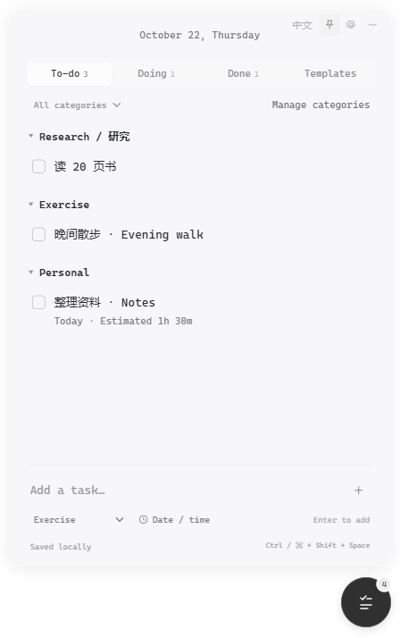
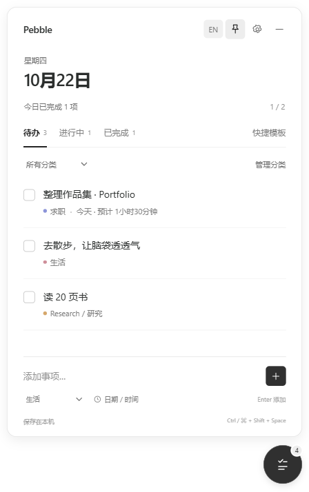

# Pebble · 悬浮待办

Minimal floating tasks for Windows and macOS.

一个安静的桌面悬浮小球，鼠标停留后展开待办列表。面向 **Windows 与 macOS**，不需要账号，事项保存在自己的电脑上。



## v0.5.0

- 新增本地 MCP 服务，面向 Codex、Claude Code 和 Claude Desktop 的本地接入，提供添加事项、查询事项、读取分类和本机日期时区四个工具。
- 设置 → AI 连接可开启 / 停止访问，并复制 Codex 或 Claude 配置；详情见 [AI 连接说明](docs/ai.md)。
- AI 添加成功后列表与小球数字即时刷新。支持中英文、日期、跨午夜时间段、预计时长和重复请求去重。
- GUI 与 AI 写入统一排队，检测旧快照并保留编辑草稿，避免并发覆盖。

Windows 试用文件在 `release-v0.5/`，直接运行 `release-v0.5/win-unpacked/Pebble.exe`。

### v0.4.2

- 自建分类接入离线常用词对照，例如 `life` / 生活、`work` / 工作、`travel` / 旅行；按界面语言显示，不改写原分类名或事项内容。
- “管理分类”中每个分类可展开填写可选的英文和中文名称，优先使用用户填写的名称；清空后恢复常用词或原名。未收录的名称保留原文。
- 分类中英文名称随本地数据保存，备份导入导出与重启保留。

Windows 试用文件在 `release-v0.4.2/`，直接运行 `release-v0.4.2/win-unpacked/Pebble.exe`。

### v0.4.1

- 悬浮球改为清透玻璃效果：中心几乎透明，只保留轻微反光和纤细边缘；减轻阴影，悬停也不增加底色厚度。
- Logo 与待办数字保持独立清晰度。

Windows 试用文件在 `release-v0.4.1/`，直接运行 `release-v0.4.1/win-unpacked/Pebble.exe`。

### v0.4.0

- 小球改为浅色半透明渐变，细边框、轻阴影与简洁的 Pebble P 标记。
- To-do 为 0 时显示 Logo；有待办时，球中央显示完整 To-do 数量。Doing 和 Done 不计入数字，不再使用角落徽标。
- 小球位于面板上方，面板向下展开、向上收回；快速反向操作会接续当前动画。
- 贴近左边缘时面板向右延伸；贴近底部时自动上移，给向下展开留出空间。收起后球停在展开时的位置。
- 默认初始位置改为屏幕右上方；保留已有位置，并在必要时调整到可完整显示面板的位置。
- 窗口位置写入与任务写入串行处理，避免移动窗口时覆盖正在保存的任务。

Windows 试用文件在 `release-v0.4/`，直接运行 `release-v0.4/win-unpacked/Pebble.exe`；安装包为 `Pebble Setup 0.4.0.exe`。

### v0.3.0

- 按用户提供的界面参考改为半透明便签布局：顶部小日期、等宽字体、按分类分组，移除逐项分隔线和主界面进度统计。
- 悬停事项时轻微放大和浮起，其他事项缩小并淡出；移开后恢复。支持减少动态效果的系统偏好。
- 分类标题可以折叠和展开。
- 移除默认“求职”分类与未修改的求职快捷模板。旧事项保留并移至未分类；自定义名称、模板和分类不被覆盖。
- 默认面板不透明度为 82%，旧版默认 94% 会更新；用户已经设置的其他透明度会保留。

Windows 试用文件在 `release-v0.3/`，直接运行 `release-v0.3/win-unpacked/Pebble.exe`；安装包为 `Pebble Setup 0.3.0.exe`。

### v0.2.0

- 黑白灰简约界面：列表分隔线、统一系统字体、圆形悬浮球；移除宣传语、渐变、装饰图形和独立任务卡片。
- 默认英文，点击右上角 `中文` 或在 Settings → Language 中切换完整中文界面。选择会保存，默认分类、模板、时间单位、操作提示及原生右键菜单跟随界面语言；用户输入的事项和自定义名称保持原样。
- 主界面 `Manage categories` 可管理分类；新增事项、编辑事项和创建模板的分类下拉框都支持 `+ New category…`。分类名称与颜色可直接编辑，离开字段后自动保存。
- 旧版任务数据兼容。未改名的默认分类和模板会迁移为可翻译的预设；用户改过的名称保留。
- 展开和收起时显式恢复置顶，修复此前置顶状态检查失败。

此前试用目录暂时保留。

### MVP 功能

- 悬浮置顶、拖动移动、接近屏幕边缘时吸附；鼠标停留 300 毫秒展开，移开后延迟收起。
- To-do / Doing / Done 三个状态，每个状态都能添加事项。
- 单击左侧方框：待办 → 进行中 → 完成 → 待办；单击事项正文编辑或直接改到任意状态。
- 自定义分类、分类颜色与分类筛选。删除分类时保留事项和模板。
- 可选任务日期、预计时长，或开始 / 结束时间；自动计算小时和分钟，并标明跨午夜的“次日”。
- 填写开始时间和时长，推算结束时间。同一开始 / 结束时间会提示无效，跨天时间段最多小于 24 小时；更长的计划可以使用预计时长。
- 运动、学习等快捷模板；使用时选择目标状态、日期和时间，也可以创建自己的模板。
- 默认英文界面和日期，右上角切换完整中文；点击日期可单独切换日期语言。常见自建分类名自动切换中英文，其他分类可设置双语名称。文字颜色和面板不透明度可以调整。
- 本地持久保存、上一次写入的自动备份、JSON 导入导出、最近一次修改可撤销。
- 托盘 / 菜单栏入口，以及 `Ctrl + Shift + Space`（Windows）/ `⌘ + Shift + Space`（macOS）快速唤出。

不包含：云端同步、提醒通知、自动重复事项、实际用时计时器、开机启动。设置的时长是计划信息，不会自动把事项标记完成。

## 启动开发版

需要 Node.js 24 LTS 和 npm。

```sh
npm ci
npm start
```

Windows 可以双击 `Start Pebble.cmd`。依赖首次安装需要联网；完成安装后应用本身可以离线使用。

## 使用

1. 鼠标停留在小球上展开，也可以直接单击。
2. 选择一个状态，在底部输入事项，按 Enter 添加。分类在输入框下面选择。
3. 要设置时间，点击“日期 / 时长”。也可以先快速记下，随后点击事项编辑。
4. 点击右上角图钉保持展开；点击减号收起。输入和弹窗操作期间不会因鼠标移开而突然收起。
5. 拖动小球移动。右键小球，或右键托盘 / 菜单栏图标，可退出程序。

列表按分类分组，保留所有日期的事项；点击分类标题可以折叠。主界面不再显示进度统计。

中文预览：



## 本地数据

- Windows：`%APPDATA%/Pebble/tasks.json`
- macOS：`~/Library/Application Support/Pebble/tasks.json`
- 自动备份：同目录 `tasks.json.backup`，保存上一次写入的有效数据。
- 检测到主文件损坏且有有效备份时，从备份恢复并保留损坏原文件；没有有效备份时会明确报错，不覆盖原文件。
- 导入会替换当前数据，操作前会要求确认。重要数据请定期使用“导出备份”另存。
- 应用不发送遥测、不请求外部资源。只有开启 AI 连接后，才会启动经过令牌鉴权的本机回环接口。数据没有加密，使用电脑账户本身的访问权限保护。

## 测试与打包

```sh
npm test               # 时间计算、数据校验、持久化与备份恢复
npm run test:desktop   # 实际 Electron 窗口的交互回归测试
npm run build:mcp      # 构建供 AI 客户端调用的独立本地桥接文件
npm run test:mcp       # 隔离数据目录中的 MCP 与界面联动测试
npm run pack           # 当前系统的可运行目录
npm run dist:win       # 在 Windows 上生成安装程序与 zip
npm run dist:mac       # 在 macOS 上生成 dmg 与 zip
```

安装文件生成到 `release/`。桌面测试使用系统临时目录，不写入真实用户事项；截图保存在 `test-results/`。

`.github/workflows/build.yml` 提供 Windows 与 macOS 的手动构建，以及 `v*` 标签构建。macOS 构建包含 Apple Silicon 和 Intel。工作流只生成可下载产物，不自动发布 Release，也不推送代码。当前默认不签名；对外分发前应配置 Windows 代码签名与 Apple 签名 / 公证。

**平台验证范围**：Windows 可在本机进行运行验证。macOS 已配置同一套实现与打包流程，但需要在 Mac 上构建并验收透明窗口、屏幕缩放、多显示器、菜单栏与快捷键；配置文件本身不代表已验证通过。

## AI 接入

任务数据结构与校验集中在 `src/domain.js`，磁盘存储在 `electron/store.cjs`，GUI 与 AI 共用 `electron/task-service.cjs`。本地桥接在 `electron/ai-bridge.cjs`，MCP stdio 入口在 `mcp/entry.cjs`。

自然语言解析由 AI 应用承担。首版提供读取与新增，暂不通过 MCP 修改或删除已有事项。复制配置、客户端说明和验证范围见 [AI 连接说明](docs/ai.md)。

## 项目结构

```text
electron/      原生窗口、托盘、受限的桌面桥接、本地存储
src/           页面、样式、交互与共享数据校验
assets/        应用图标与托盘图标
tests/         数据测试与真实桌面交互测试
mcp/           MCP stdio 服务、独立打包与客户端配置生成
.github/       双平台打包工作流
```

本项目当前先在本地开发；GitHub 账号、仓库名和可见性确认后再上传。
