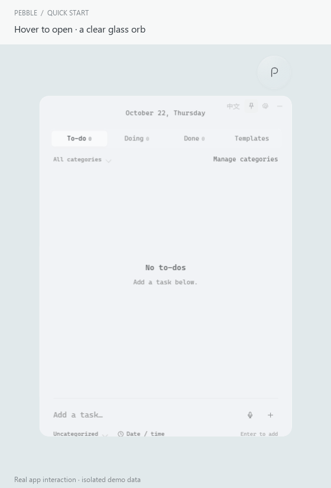
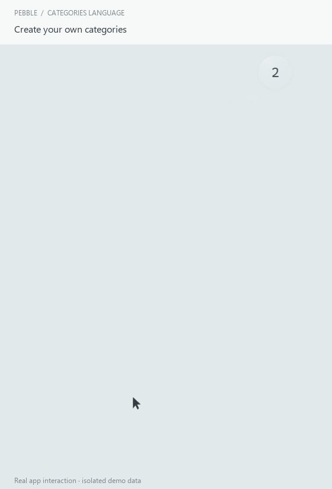
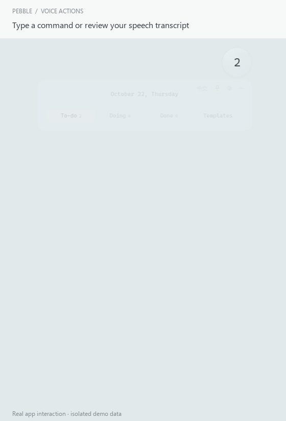
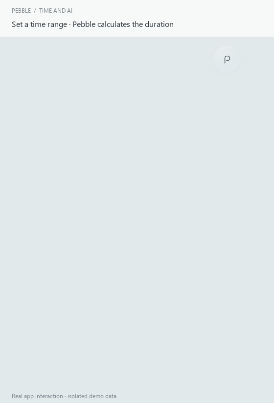
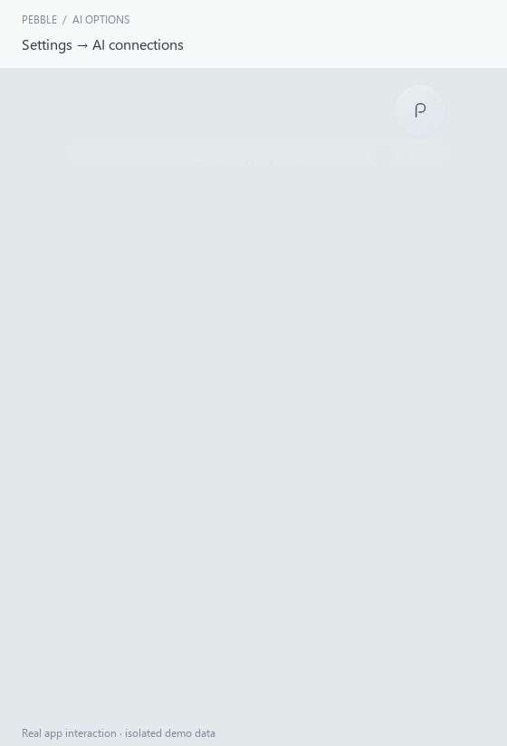

<p align="center"></p>

# Pebble

A transparent floating to-do list for **Windows and macOS**, with local **voice input, Skills and MCP tools for Codex and Claude**.

[中文说明](README.zh-CN.md) · [Download v0.6.1](https://github.com/chenwy777/pebble-todo/releases/tag/v0.6.1) · [Installation](#installation) · [AI connections](#connect-codex-or-claude) · [Changelog](CHANGELOG.md)

Pebble stays on your desktop as a small glass orb. Hover to unfold the list downward, add a task, and return to what you were doing. Your tasks are stored on your computer; no Pebble account is required.

**New in 0.6.1:** free local Chinese / English voice input, commands to add / complete / start / reopen tasks across tabs, one-click Codex / Claude Code Skill installation, and category emoji with a 12-color palette. The main list keeps its neutral text. [Release notes](docs/releases/v0.6.1.md) · [Voice guide](docs/voice.md).

<p align="center"></p>

_Actual Electron app interaction using disposable demo data. The neutral backdrop and captions are added for readability._

## What it does

| Feature                | Behavior                                                                                                     |
| ---------------------- | ------------------------------------------------------------------------------------------------------------ |
| Floating glass orb     | Drag to move; hover or click to open. The list unfolds downward.                                             |
| Remaining-task counter | Shows the P logo when To-do is empty, otherwise the full To-do count. Doing and Done are excluded.           |
| Three task states      | Add tasks directly to To-do, Doing or Done. Click a task's checkbox to advance its state.                    |
| Hover focus            | The hovered row lifts slightly while other rows fade and shrink. Reduced-motion preferences are respected.   |
| Custom categories      | Custom names, emoji, 12 preset colors and custom colors; the main list remains neutral.                                |
| Planned time           | Optional date, duration, start time, or start/end time. Pebble calculates hours and minutes and labels overnight ranges. |
| Quick templates        | Reuse built-in activities or create your own templates, then choose the destination state.                   |
| English / Chinese      | English by default; switch the interface with 中文 / EN. Click the date to switch its language separately.   |
| Local voice            | Chinese / English transcription on your computer; review commands before adding or moving tasks. |
| Local data             | Automatic local saves, previous-write backup, JSON import/export and undo for recent manual changes.         |
| Optional AI tools      | Install a local Codex / Claude Code Skill, or use the existing MCP connection to read / add tasks.                                          |

## Installation

### Choose your download

Open the [v0.6.1 release](https://github.com/chenwy777/pebble-todo/releases/tag/v0.6.1) and expand **Assets** if needed. Download the installer matching your computer; the GitHub **Source code** archives are for developers.

| Your computer                   | Recommended download                                                                                                | ZIP alternative                                                                                                     |
| ------------------------------- | ------------------------------------------------------------------------------------------------------------------- | ------------------------------------------------------------------------------------------------------------------- |
| Windows x64                     | [Windows installer](https://github.com/chenwy777/pebble-todo/releases/download/v0.6.1/Pebble-0.6.1-windows-x64.exe) | [Windows ZIP](https://github.com/chenwy777/pebble-todo/releases/download/v0.6.1/Pebble-0.6.1-windows-x64.zip)       |
| Mac with an Apple M-series chip | [Apple Silicon DMG](https://github.com/chenwy777/pebble-todo/releases/download/v0.6.1/Pebble-0.6.1-macos-arm64.dmg) | [Apple Silicon ZIP](https://github.com/chenwy777/pebble-todo/releases/download/v0.6.1/Pebble-0.6.1-macos-arm64.zip) |
| Mac with an Intel processor     | [Intel DMG](https://github.com/chenwy777/pebble-todo/releases/download/v0.6.1/Pebble-0.6.1-macos-x64.dmg)           | [Intel ZIP](https://github.com/chenwy777/pebble-todo/releases/download/v0.6.1/Pebble-0.6.1-macos-x64.zip)           |

**Node.js is not required to use the desktop app.** The MCP setup below requires Node.js; the one-click Skill installer reuses Pebble's own runtime.

### Windows

1. If an older Pebble is running, right-click its orb and choose **Quit Pebble**.
2. Download and run `Pebble-0.6.1-windows-x64.exe` from this repository's release.
3. Choose the installation folder and finish the installer.
4. Open **Pebble** from the Start menu or desktop shortcut. Look for the floating orb; Pebble does not use a normal taskbar window.

For the ZIP version, choose **Extract All**, keep the entire extracted folder together, and run `Pebble.exe` inside it. Copying only the `.exe` will leave behind required resources. Windows 11 x64 is the local validation environment; other Windows configurations are not yet individually verified.

These preview installers do not have a publisher certificate, so Windows may show an unrecognized-publisher warning. Verify the repository and file before deciding whether to run it. Asset hashes are published in `SHA256SUMS.txt`; PowerShell can calculate one with `Get-FileHash -Algorithm SHA256 .\Pebble-0.6.1-windows-x64.exe`.

### macOS

1. Open **Apple menu → About This Mac**. A **Chip** entry such as Apple M1/M2/M3/M4 means **arm64**; an **Intel Processor** entry means **x64**.
2. Download the matching `.dmg`, open it, and drag **Pebble** to **Applications**.
3. If replacing a previous version, quit the old Pebble first. Open the new app from Applications and look for the orb or menu-bar icon.
4. If using the ZIP instead, extract it and move `Pebble.app` to Applications before opening it.

The preview is not signed with an Apple Developer ID or notarized. If macOS blocks opening it, review [Apple's guidance](https://support.apple.com/en-au/102445). For a trusted download, Apple's per-app flow is **System Settings → Privacy & Security → Open Anyway** after the first attempt to open it. This does not require turning Gatekeeper off globally. To check a download, run `shasum -a 256 /path/to/download.dmg` and compare it with `SHA256SUMS.txt`.

Mac installers are produced by separate Apple Silicon and Intel CI jobs. Packaging and unit tests do not replace manual checks of transparency, dragging, multiple displays, menu-bar behavior or system shortcuts on a real Mac; that acceptance work is still pending.

### Update or uninstall

Export a JSON backup in **Settings → Export backup** before upgrading. Quit the old version, then install or open the new one. Data is stored separately from the application and should load automatically. If you move or reinstall Pebble, reinstall its Skill or copy its MCP configuration again so the launcher points to the new location.

Uninstall the Windows application normally, or remove `Pebble.app` on macOS. ZIP users can remove the extracted application folder after quitting. Removing the app does not require deleting your separate task-data folder.

## First use

1. **Open:** hover over the orb, click it, or use the shortcut below.
2. **Add:** choose To-do / Doing / Done, enter a task in the bottom field, choose a category and press **Enter**.
3. **Schedule:** use **Date / time** for a date, a duration, or a start/end range. Existing tasks can be edited by clicking their title.
4. **Advance:** click the checkbox next to a task: **To-do → Doing → Done → To-do**. The editor can move it directly to any state.
5. **Keep open:** click the pin. Use the minus button to collapse.
6. **Move or quit:** drag the orb to move it; right-click it or the tray/menu-bar icon to quit.

| Action                          | Windows                | macOS               |
| ------------------------------- | ---------------------- | ------------------- |
| Open and focus task entry       | `Ctrl + Shift + Space` | `⌘ + Shift + Space` |
| Collapse when no dialog is open | `Esc`                  | `Esc`               |

Tasks are shown across all dates, grouped by category. A planned date or duration does **not** schedule a notification or automatically complete a task.

### Categories and language

Use **Manage categories** or **+ New category…** in a category selector. Changes save when you leave a field. Deleting a category keeps its tasks and templates as Uncategorized.

Common category names have a local English/Chinese lookup (`life` → 生活, `work` → 工作). For any other name, expand **Translations (optional)** and enter English and Chinese labels. Your labels take priority; an unknown name without a translation stays as entered. Task text and custom template titles remain unchanged when you switch the interface language.

<p align="center"></p>

Category colors and emoji appear in the manager and **open category options only**. Closed selectors, headings and task text keep the same neutral color. Choose a preset or any custom color; emoji are optional.

### Voice input and task commands

Click the microphone beside task entry, choose Chinese or English and start recording. First use downloads a free local speech model (about **250 MB**); after caching, recognition works offline. Audio stays in memory on your computer. Allow microphone access when asked. Intel Macs use a slower WASM fallback.

Review the transcript, click **Review command**, check the action and target task, then **Apply**. You can also type the command directly. `Complete the meeting` moves a matching task to Done even if you opened the dialog from To-do. `Start the meeting` moves it to Doing; `Reopen the meeting` moves it to To-do. Multiple matches require a choice; missing matches are not inserted as new tasks. The Action selector lets you correct the intent.

This is a limited local command parser, not a general AI model. Check recognition and the preview before applying. See [supported commands, download and privacy details](docs/voice.md).

<p align="center"></p>

_This recording types commands to demonstrate transcript review and task actions; it does not demonstrate microphone recognition._

### Time ranges and AI additions

A range such as **19:00 → 20:30** displays **1h 30m**. A range ending earlier than it starts crosses midnight; equal start and end times are invalid. Use Duration for a plan longer than a day.

The second half of this recording performs a real `pebble_add_task` MCP call against the running demo instance. It demonstrates the integration and automatic refresh, rather than a simulated chat in a particular AI client.

<p align="center"></p>

## Connect Codex or Claude

### Option 1: Skill (one-click installation)

In **Settings → AI connections**, choose **Install Codex Skill** or **Install Claude Code Skill**, enable AI access, then restart the client or open a new chat. Invoke `$pebble-todo` in Codex or `/pebble-todo` in local Claude Code. There is no MCP configuration to copy and no separate Node installation for this route. It supports the same four read / add operations as MCP; existing task editing/completion is not included. This local Skill requires access to the same computer, not an isolated cloud chat.

The original MCP route remains available. Use it for compatible clients, including Claude Desktop, or when you prefer registered tools. See [both setup options](docs/ai.md). Neither installation route overwrites the other one's configuration.

<p align="center"></p>

### Option 2: MCP (existing setup)

Pebble exposes an MCP server that a compatible AI client can start locally. The AI client interprets your request; Pebble validates and saves the task. Pebble itself does not need a model API key.

1. Install **Node.js 20+**; Node.js 24 is the development version used here.
2. Keep Pebble running and open **Settings → AI connections**.
3. Enable **Allow AI apps to read and add tasks**.
4. Copy the appropriate configuration and merge it into the client's settings. Preserve your existing MCP servers.
5. Restart the AI client so it loads the new tools.

| Client         | Where to put the generated configuration                                                                                             |
| -------------- | ------------------------------------------------------------------------------------------------------------------------------------ |
| Codex          | Add the copied TOML section to `~/.codex/config.toml`. Update an existing `[mcp_servers.pebble]` section rather than duplicating it. |
| Claude Code    | Merge `mcpServers.pebble` from the copied JSON into the project's `.mcp.json`, or register it using `claude mcp add`.                |
| Claude Desktop | Open Settings → Developer → Edit Config and merge the copied JSON into `claude_desktop_config.json`.                                 |

Claude Desktop's configuration is normally at `%APPDATA%/Claude/claude_desktop_config.json` on Windows or `~/Library/Application Support/Claude/claude_desktop_config.json` on macOS. If the client cannot find `node`, set `command` to Node's absolute executable path. Local stdio connections run on the desktop; a web chat cannot directly start a process on your computer.

Try: **“Add reviewing my CV tonight from 7 to 8 to my Study to-dos.”** Or: **“Show my remaining to-dos.”**

| Tool                     | Purpose                                                           |
| ------------------------ | ----------------------------------------------------------------- |
| `pebble_get_context`     | Read the local date, timezone, language and task counts.          |
| `pebble_list_categories` | Read category IDs and English/Chinese names.                      |
| `pebble_list_tasks`      | Search by status, category, date or title, with pagination.       |
| `pebble_add_task`        | Add a task with optional status, category, date and planned time. |

The local bridge is off by default. When enabled, it uses an authenticated loopback connection; turning access off or quitting Pebble stops access. The current MCP tools do not edit or delete existing tasks. Protocol tests cover SDK v2 and three older protocol versions; Claude client UI acceptance and other clients such as Gemini / WorkBuddy remain to be verified. DeepSeek support depends on the client using the model.

References: [Codex MCP](https://learn.chatgpt.com/docs/extend/mcp?surface=cli), [Claude Code MCP](https://code.claude.com/docs/en/mcp), [local Claude Desktop setup](https://modelcontextprotocol.io/docs/develop/connect-local-servers). More implementation and configuration detail is in the [Chinese AI connection guide](docs/ai.md).

## Data and backups

| System  | Task file                                         |
| ------- | ------------------------------------------------- |
| Windows | `%APPDATA%/Pebble/tasks.json`                     |
| macOS   | `~/Library/Application Support/Pebble/tasks.json` |

The previous valid write is retained as `tasks.json.backup`. If the main file is damaged, Pebble attempts to restore that backup and keeps the damaged original. Use **Settings → Export backup** for a separate copy; importing a backup replaces the current list after confirmation.

The app does not send telemetry or load external page resources. Optional voice setup downloads model files from Hugging Face; subsequent speech recognition runs locally using the cached model. Models are stored in `voice-models/` inside the app data folder, separately from task backups. Task data is not encrypted; it uses your OS account's file permissions. When AI access is enabled, its temporary discovery file is under the data folder's `ai/connection.json`; do not share that file. Configuration copied for an AI client does not contain the connection token.

## Troubleshooting

| Problem                                | What to check                                                                                                                            |
| -------------------------------------- | ---------------------------------------------------------------------------------------------------------------------------------------- |
| No normal app window or taskbar icon   | Pebble is an orb/tray application. Check the desktop orb or use the open shortcut.                                                       |
| The old UI is still shown              | Quit the older process before opening a new build; Pebble normally runs as one instance.                                                 |
| ZIP build will not start               | Extract the entire ZIP and keep all resources beside the executable.                                                                     |
| Mac download will not open             | Confirm the processor architecture and review the macOS installation notes above.                                                        |
| A custom category stays in English     | Expand its translation fields, or leave an unrecognized name unchanged intentionally. Only known category words translate automatically. |
| MCP reports that Pebble is unavailable | Run Pebble, enable AI access, verify the generated path and Node executable, then restart the AI client.                                 |
| Shortcut does not open Pebble          | Another application may own that shortcut. Use the orb or tray/menu-bar icon.                                                            |

For a bug report, include the Pebble version, operating system, processor type, steps to reproduce and a screenshot without personal task content. [Open an issue](https://github.com/chenwy777/pebble-todo/issues).

## Development and validation

Use Node.js 24 and npm:

```sh
git clone https://github.com/chenwy777/pebble-todo.git
cd pebble-todo
npm ci
npm start
```

Windows developers can also use `Start Pebble.cmd` after dependencies are installed.

```sh
npm test               # Data, time, storage, layout and local AI bridge checks
npm run build:mcp      # Bundle the independent Node MCP bridge
npm run test:desktop   # Electron interaction regression
npm run test:mcp       # MCP ↔ running Electron integration
npm run test:features  # Category colors / emoji and voice preview
npm run test:voice-actions # Cross-tab command interpretation
npm run test:skill     # Isolated Skill installation and live operations
npm run pack           # Unpacked app for the current OS
npm run dist:win       # Windows installer + ZIP, on Windows
npm run dist:mac       # DMG + ZIP, on macOS
```

Builds go into `release/`. Desktop/MCP tests use temporary data folders, not your real tasks. The release workflow builds Windows x64, macOS arm64 and macOS x64 separately, runs unit tests, then attaches installers and SHA-256 checksums to a version-tagged GitHub preview release. Local Windows desktop/MCP regression is complete; packaging success is kept separate from pending manual Mac and Claude client acceptance. See [validation details](VALIDATION.md).

To reproduce the README recordings:

```sh
npm run build:mcp
npm run demo:record
python -m pip install Pillow
python scripts/encode-demos.py
```

The recorder drives the real Electron app and a real local MCP client using isolated sample tasks. PNG frames are temporary in `test-results/demo-frames`; the encoder adds only captions, a neutral backdrop and timing to the GIFs in `docs/demos`.

```text
electron/   Native window, storage, shared task service and private local bridge
src/        Interface, styling, translations and shared data validation
mcp/        Stdio MCP server, bundle and configuration generation
skills/     Optional Pebble Skill and local operation helper
tests/      Unit, desktop and MCP integration checks
scripts/    Real interaction recording, GIF encoding and asset checksums
docs/       Demos, AI setup, validation/design context and release notes
```

## Current scope

Pebble 0.6.1 is a desktop preview. It does not yet include cloud sync, reminder notifications, recurring tasks, automatic startup, actual time tracking or MCP editing/deletion. These limits are also listed in the release notes; planned duration is not a timer or an alarm.
